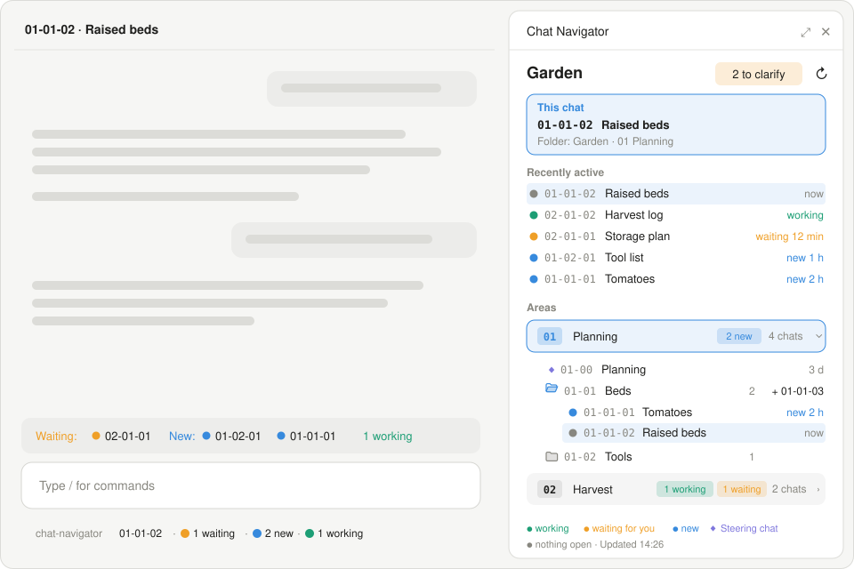

# Chat-Navigator

[English](README.md) · **Deutsch**

Ein Plugin für die **Claude Desktop-App** (Code-Tab), wenn ein Projekt viele Chats hat. Es zeigt alle Chats
eines Projekts als nummerierten Baum in einem Panel neben dem Chat und hält die Ordnung selbst sauber.



- **Baum:** Bereiche (`01`), Unterordner (`01-02`) und Chats (`01-02-03 · Titel`); Steuerchats `NN-00`.
- **Dieser Chat:** der aktuelle Chat ist hervorgehoben, sein Bereich aufgeklappt.
- **Zuletzt bearbeitet:** die letzten 10 Chats, mit Status: arbeitet, wartet auf dich, neu.
- **Zu klären:** Chats ohne Nummer, im falschen Seitenleisten-Ordner oder mit doppelter Nummer.
- **Suche:** filtert beim Tippen alle Chats nach Titel oder Nummer.
- **Rückblick:** die Bereiche, an denen du diese Woche am meisten gearbeitet hast, mit Balken; ein Klick zeigt die Chats des Bereichs.
- **Aufräumen:** listet lange unbenutzte Chats und legt sie mit einem Klick in die Ablage des Navigators
  (in der App bleiben sie, wie sie sind).
- **Nummeriert selbst:** Ein Chat, der aus einem nummerierten Chat gestartet wurde, erbt die nächste freie
  Nummer. Liegt ein Chat im falschen Seitenleisten-Ordner, sagt «Zu klären», wohin er gehört; verschieben
  tust du ihn selbst (die App lässt ein Plugin andere Chats nicht ohne Rückfrage verschieben).
- **Zeile über dem Eingabefeld:** wer wartet, was neu ist, wie viele arbeiten; ein Klick öffnet den Chat.
- **Statusleiste:** Nummer dieses Chats und offene Punkte, z. B. `01-01-01 · 🟠 2 wartet · 🔵 1 neu`. Auf Wunsch
  läuft ein Krebs 🦀 darüber, solange ein Chat auf dich wartet.
- Öffnet sich in jedem Chat des Projekts von selbst, nicht in geplanten Läufen und nicht dort, wo du es
  geschlossen hast. Mehrere Projekte gehen nebeneinander, jedes mit eigener Einstellungsdatei.
- Oberfläche auf Englisch oder Deutsch.
- Passt sich der Breite des Panels in drei Stufen an: Standard, klein (kleinere Schrift, kürzere Balken) und
  mini (Punkt, Titel und Zeit je Chat, Zeichen statt Wörter im Kopf).


## Installation

In einem Terminal-Chat von Claude Code:

```
/plugin install chat-navigator --marketplace tihozh/chat-navigator
```

Mit `y` den Marktplatz hinzufügen, dann den Bereich «user» wählen. Ohne Prompt:

```bash
claude plugin marketplace add tihozh/chat-navigator
```

```bash
claude plugin install chat-navigator@chat-navigator
```

In der Desktop-App: + neben dem Eingabefeld → Plugins → Marktplatz hinzufügen (`tihozh/chat-navigator`) →
Plugin hinzufügen. Danach die App neu starten.

## Einrichten

Öffne einen Chat im Projektordner und tippe:

```
/chat-navigator:setup
```

Claude liest deine Chats und Seitenleisten-Ordner, schlägt Bereiche vor, schreibt die Einstellungsdatei
und plant Nummern für die bestehenden Chats. Titel werden erst nach deinem Ja umbenannt; bis dahin zeigt
das Panel eine Vorschau. Danach öffnet `/navigator` das Panel.

Für die deutsche Oberfläche setzt du in `~/.claude/chat-navigator/config.json` den Wert `"language": "de"`.

## Einstellungen

### Zentrale Datei (alle Projekte)

`~/.claude/chat-navigator/config.json`, optional. Fehlt sie, gilt alles wie unten vorgegeben.
Beispiel: [examples/config.json](examples/config.json).

| Feld | Standard | Bedeutung |
| --- | --- | --- |
| `language` | `"en"` | Sprache der Oberfläche: `"en"` oder `"de"`. |
| `statusbar` | `true` | Eintrag in der Statusleiste an oder aus (farbige Zeichen: 🟠 wartet, 🔵 neu, 🟢 arbeitet). |
| `crab` | `false` | Solange ein anderer Chat auf dich wartet, steht unten nur `🦀 2` (Zahl der Wartenden), und der Krebs läuft hin und her. |
| `band` | `"active"` | Zeile über dem Eingabefeld: `"off"`, `"active"` (nur wenn etwas wartet, neu ist oder arbeitet) oder `"always"`. Die früheren Werte `"aus"`, `"offen"`, `"immer"` gelten weiter. |
| `features` | alle `true` | Teile des Panels: `search`, `week` (Rückblick), `cleanup`. Auf `false` gesetzt, verschwindet der Teil. |
| `settings` | siehe unten | Vorgaben für alle Projekte; eine Projektdatei überschreibt sie einzeln. |

### Projektdateien

Eine Datei je Projekt in `~/.claude/chat-navigator/<name>.json`. Beispiel:
[examples/project.json](examples/project.json).

| Feld | Pflicht | Bedeutung |
| --- | --- | --- |
| `project` | ja | Absoluter Pfad des Projektordners. Chats in diesem Ordner und darunter gehören dazu; bei verschachtelten Projekten gewinnt der längste Pfad. |
| `areas` | ja | Bereiche mit `id` (zwei Ziffern), `name`, `subs` (Unterordner, `id` wie `01-02`) und optional `group`: der genaue Name des Seitenleisten-Ordners für diesen Bereich. |
| `name` | nein | Überschrift im Panel. |
| `register` | nein | Geplante oder vergebene Nummern: `"01-02-03": { "session": "<id>", "title": "<alter Titel>" }`. Der Navigator ergänzt es selbst. |
| `archive` | nein | Ablage: `area` (Standard `99`) und `sessions` (IDs von Chats, die dorthin gehören, mit oder ohne Nummer). «Aufräumen» ergänzt sie; eine ID entfernen holt den Chat zurück. |
| `runs` | nein | Automatische Läufe: `area` (Standard `90`) und `patterns` (Textstücke im Titel). |
| `settings` | nein | `staleDays` (14), `recent` (10), `pollMinutes` (1), `waitingHours` (48), `autoFix` (`true`: Nummern selbst vergeben; `false`: nur melden). |

Seitenleisten-Ordner gelten für alle Projekte gemeinsam. Ohne `group` erwartet der Navigator einen Ordner,
der mit der Bereichsnummer beginnt (z. B. `01 Planung`). Wer mehrere Projekte ordnet, gibt jedem Bereich
mit `group` einen eigenen Ordner (z. B. `Garten · 01 Planung`).

## Was das Plugin auf deinem Computer tut

Der Navigator arbeitet nur lokal, in der Desktop-App. Er sendet nichts ins Internet und holt nichts von dort.

- **App-Dienste, die er selbst aufruft** (ohne dass das Modell fragt), über die MCP-Server der App:
  - `ccd_session_mgmt`: `list_sessions` und `get_session` (Chats und ihre Titel, jede Minute und beim Öffnen
    des Panels), `list_events` (die letzten Beiträge eines kürzlich aktiven Chats, um zu sehen, ob er auf
    dich wartet), `set_session_title` (setzt eine Nummer vor den Titel eines Chats, nur mit `autoFix` an).
  - `ccd_sidebar`: `list_groups` (Seitenleisten-Ordner, um zu prüfen, ob ein Chat im Ordner seines Bereichs
    liegt).
  - Ist ein Dienst beim Start eines Chats noch nicht verbunden, verbindet er ihn (`mcp.connect`) und versucht
    es nochmals.
- **Programme, die er startet:** nur den macOS-Befehl `open` mit einem `claude://`-Link auf einen Chat, wenn
  du im Panel oder in der Zeile über dem Eingabefeld auf einen Chat klickst. Links, die nicht mit `claude://`
  beginnen, werden nicht geöffnet.
- **Dateien, die er liest:** seine Einstellungen in `~/.claude/chat-navigator/` und, wenn ein App-Dienst eine
  grosse Antwort als Datei ablegt, diese Datei im Ergebnisordner der App.
- **Dateien, die er schreibt:** nur die Projektdateien in `~/.claude/chat-navigator/`: neue Nummern in
  `register` und mit «Aufräumen» abgelegte Chats in `archive`. Andere Felder bleiben unverändert. Er schreibt
  keine Build-, Start- oder Anweisungsdateien.
- **Hooks:**
  - `session.start`: liest die Einstellungen, meldet `/navigator` an und startet einen Minutentakt, der Baum,
    Zeile über dem Eingabefeld und Statusleiste auffrischt.
  - `session.attach`: Wechselst du in einen Chat, öffnet er dort das Panel oder lädt es neu.
  - `ui.close`: merkt sich, wenn du das Panel selbst schliesst, und lässt es in diesem Chat zu. Den Aufruf
    reicht er unverändert weiter.
  - `command.run` (`/navigator`): öffnet das Panel wieder.
  - `ui.render`: zeichnet das Panel und die Zeile über dem Eingabefeld; sonst ändert er nichts am Bildschirm.
- **Gemeinsamer Speicher:** kleine Marken im Plugin-Speicher der App (welche Chats du gesehen hast, wo das
  Panel geschlossen wurde, eine kurze Sperre, damit nur ein Chat aufs Mal nummeriert).

## Voraussetzungen und Grenzen

- Nur in der Claude Desktop-App: Der Navigator braucht deren Dienste für Chats und Seitenleiste.
- macOS: Chats werden mit dem Systembefehl `open` geöffnet.
- Die App liefert höchstens 300 Chats auf einmal; ältere fehlen im Baum. Bei mehr als 300 Chats vergibt der
  Navigator keine Nummern selbst, weil ältere Chats fehlen könnten.
- Mehrere Chats eines Projekts können gleichzeitig nummerieren; eine Sperre im gemeinsamen Speicher verhindert
  das meist, ist aber nicht atomar. Das Register überschreibt nie eine Nummer, die schon einem anderen Chat gehört.
- «Wartet auf dich» ist eine Schätzung: der letzte Beitrag von Claude endet mit einer Frage.

## Entwicklung

Siehe [README.md](README.md#development).

## Lizenz

MIT, siehe [LICENSE](LICENSE).
