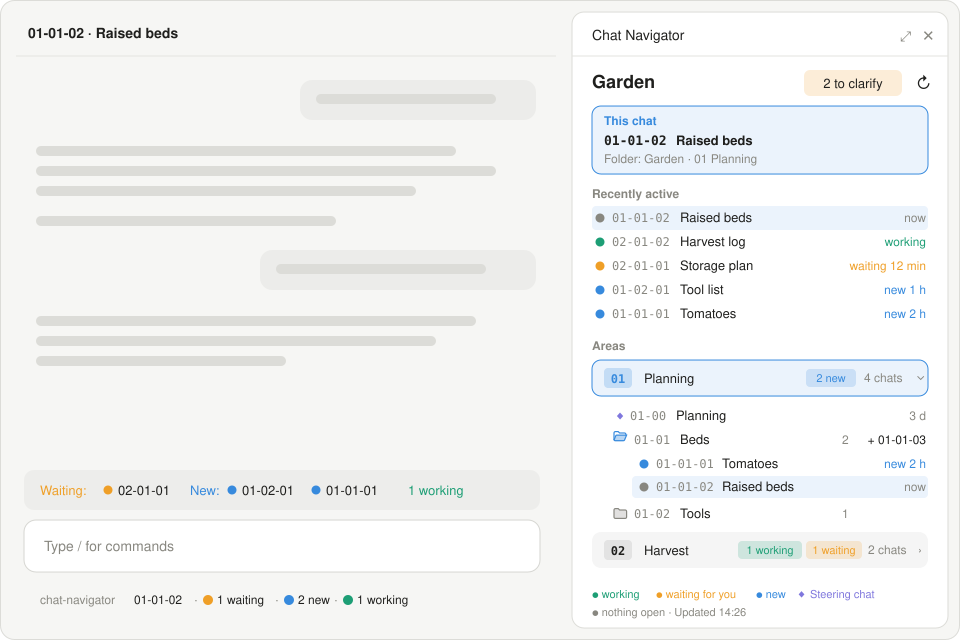

# Chat Navigator

**English** · [Deutsch](README.de.md)

A plugin for the **Claude desktop app** (Code tab) for projects with many chats. It shows all chats of a
project as a numbered tree in a pane next to the chat and keeps the order tidy.



- **Tree:** areas (`01`), sub-folders (`01-02`) and chats (`01-02-03 · Title`); steering chats `NN-00`.
- **This chat:** the current chat is highlighted and its area expanded.
- **Recently active:** the last 10 chats, with their state: working, waiting for you, new.
- **To clarify:** chats without a number, in the wrong sidebar group, with a duplicate number or unused for long.
- **Automatic numbering:** a chat started from a numbered chat gets the next free number. If a chat is in the
  wrong sidebar group, «To clarify» says where it belongs; moving it is up to you (the app does not let a
  plugin move other chats without asking).
- **Line above the prompt:** who is waiting, what is new, how many are working; a click opens the chat.
- **Status bar:** this chat's number and open items, e.g. `01-01-01 · 🟠 2 waiting · 🔵 1 new`. Optionally a
  crab 🦀 runs across it while a chat is waiting for you.
- Opens automatically in every chat of the project, not in scheduled runs and not where you closed it. Several
  projects work side by side, each with its own settings file.
- English and German user interface.


## Installation

In a terminal session of Claude Code:

```
/plugin install chat-navigator --marketplace tihozh/chat-navigator
```

Confirm adding the marketplace with `y`, then choose the «user» scope. Without the prompt:

```bash
claude plugin marketplace add tihozh/chat-navigator
```

```bash
claude plugin install chat-navigator@chat-navigator
```

In the desktop app: + next to the prompt box → Plugins → Add marketplace (`tihozh/chat-navigator`) → Add plugin.
Then restart the app.

## Setup

Open a chat in the project folder and type:

```
/chat-navigator:setup
```

Claude reads your chats and sidebar groups, proposes areas, writes the settings file and plans numbers for the
existing chats. Titles are only renamed after your yes; until then the pane shows a preview. After that,
`/navigator` opens the pane.

## Settings

### Central file (all projects)

`~/.claude/chat-navigator/config.json`, optional. Without it, the defaults below apply.
Example: [examples/config.json](examples/config.json).

| Field | Default | Meaning |
| --- | --- | --- |
| `language` | `"en"` | Language of the user interface: `"en"` or `"de"`. |
| `statusbar` | `true` | Status bar entry on or off (coloured marks: 🟠 waiting, 🔵 new, 🟢 working). |
| `crab` | `false` | While another chat waits for you, the status bar shows only `🦀 2` (number of waiting chats) and the crab runs back and forth. |
| `band` | `"active"` | Line above the prompt: `"off"`, `"active"` (only while something waits, is new or works) or `"always"`. |
| `settings` | see below | Defaults for all projects; a project file overrides them one by one. |

### Project files

One file per project in `~/.claude/chat-navigator/<name>.json`. Example:
[examples/project.json](examples/project.json).

| Field | Required | Meaning |
| --- | --- | --- |
| `project` | yes | Absolute path of the project folder. Chats in this folder and below belong to it; with nested projects, the longest path wins. |
| `areas` | yes | Areas with `id` (two digits), `name`, `subs` (sub-folders, `id` like `01-02`) and optionally `group`: the exact name of the sidebar group for this area. |
| `name` | no | Heading in the pane. |
| `register` | no | Planned or assigned numbers: `"01-02-03": { "session": "<id>", "title": "<old title>" }`. The navigator updates it automatically. |
| `archive` | no | Archive: `area` (default `99`) and `sessions` (ids of chats without a number that belong there). |
| `runs` | no | Scheduled runs: `area` (default `90`) and `patterns` (text found in their titles). |
| `settings` | no | `staleDays` (14), `recent` (10), `pollMinutes` (1), `waitingHours` (48), `autoFix` (`true`: assign numbers automatically; `false`: only report). |

Sidebar groups are shared by all projects. Without `group`, the navigator expects a group whose name starts
with the area number (e.g. `01 Planning`). If you organise several projects, give each area its own group with
`group` (e.g. `Garden · 01 Planning`).

## Requirements and limits

- Claude desktop app only: the navigator needs its services for chats and the sidebar.
- macOS: chats are opened with the system command `open`.
- The app lists at most 300 chats at once; older ones are missing from the tree. With more than 300 chats,
  the navigator does not assign numbers automatically, because older chats could be missing.
- Several chats of a project may try to assign numbers at the same time; a lock in the shared store prevents
  this in most cases but is not atomic. The register never overwrites a number that belongs to another chat.
- «Waiting for you» is an estimate: Claude's last message ends with a question.

## Development

```bash
claude plugin validate .
```

```bash
claude plugin test .
```

To try it without installing: `claude --plugin-dir <this folder>`. Once the app has loaded the plugin, it
places the API types in `.claude-plugin/types/`; then `tsc -p . --noEmit` checks the types.

| File | Contents |
| --- | --- |
| [hooks/logic.ts](hooks/logic.ts) | Pure logic without app access: titles, numbers, guard, project matching, status text. Covered by [tests/](tests/). |
| [hooks/i18n.ts](hooks/i18n.ts) | All visible texts in English and German. |
| [hooks/register.tsx](hooks/register.tsx) | Wiring: events, timer, opening automatically, reloading. |
| [hooks/config.ts](hooks/config.ts) | Finding and reading settings files, adding to the register. |
| [hooks/app.ts](hooks/app.ts) | Calls to the desktop app's services. |
| [hooks/state.ts](hooks/state.ts) | Pane state and per-project markers. |
| [hooks/pane.tsx](hooks/pane.tsx), [hooks/band.tsx](hooks/band.tsx) | Pane and line above the prompt. |
| [skills/setup/SKILL.md](skills/setup/SKILL.md) | Setup with `/chat-navigator:setup`. |

## License

MIT, see [LICENSE](LICENSE).
